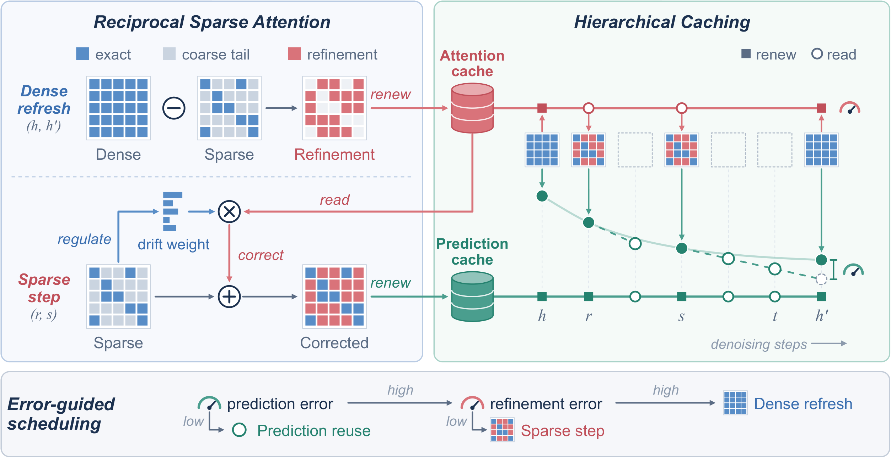
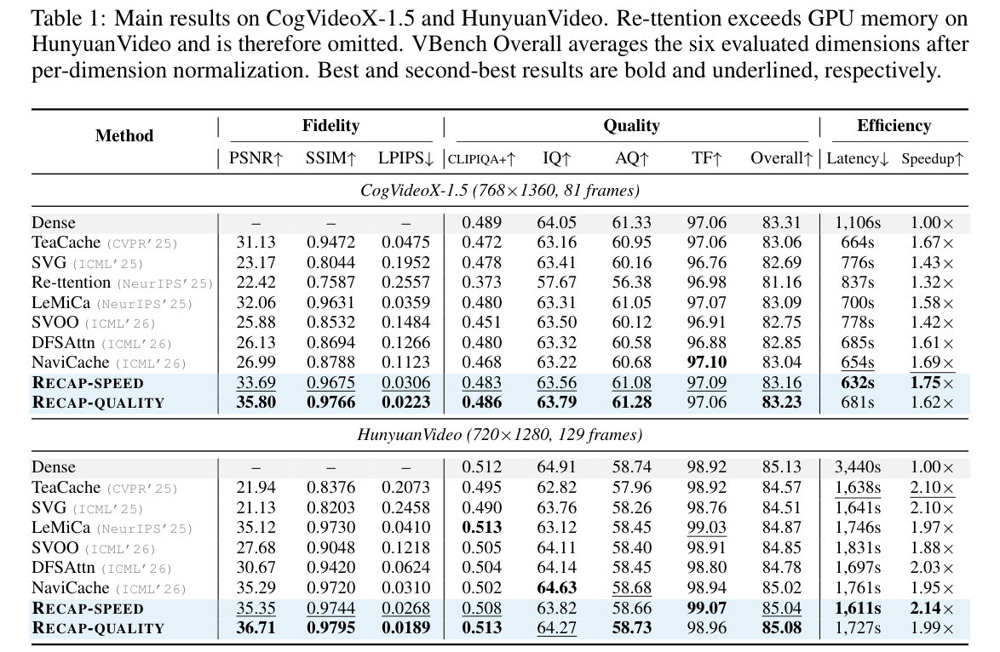
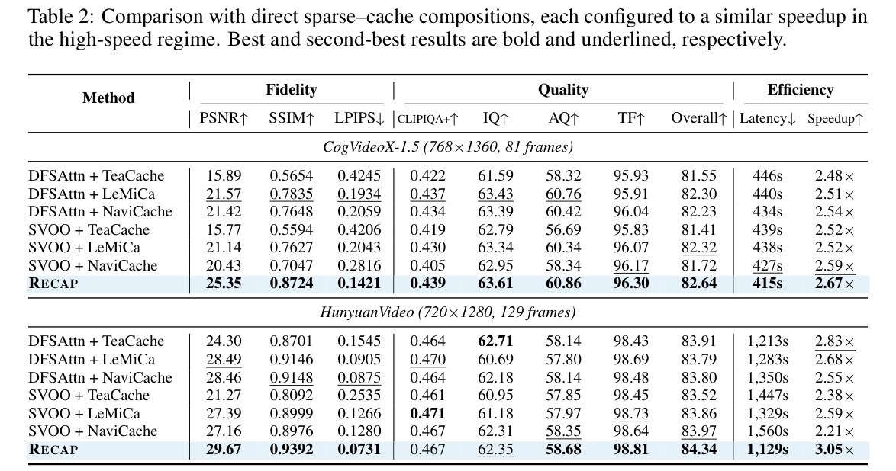
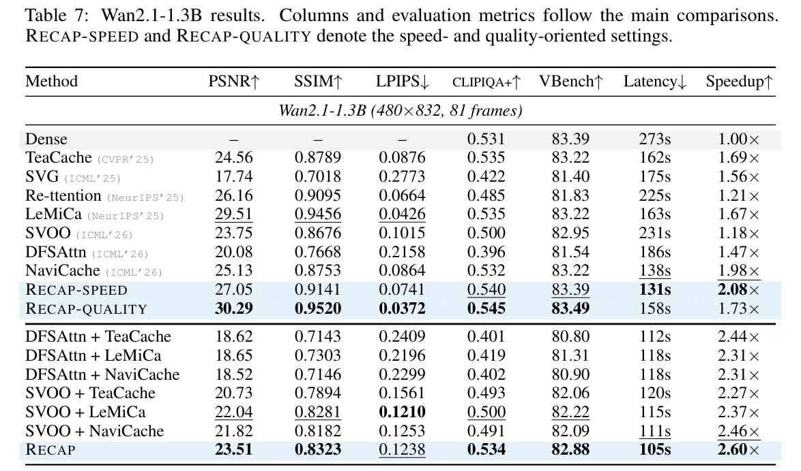

# RECAP: Reciprocal Sparse Attention and Hierarchical Caching for Efficient Video Diffusion

[Tiange Xu](https://openreview.net/profile?id=~Tiange_Xu1), [Kai Liu](https://openreview.net/profile?id=~Kai_Liu21), [Linghe Kong](https://openreview.net/profile?id=~Linghe_Kong1), and [Yulun Zhang](https://openreview.net/profile?id=~Yulun_Zhang1)

"RECAP: Reciprocal Sparse Attention and Hierarchical Caching for Efficient Video Diffusion"

---

> **Abstract:** Diffusion transformers generate high-quality videos but remain
> computationally expensive. Sparse attention and temporal caching reduce computation
> within and across denoising steps, respectively, offering a natural composition.
> However, predictions produced with sparse attention become sources for temporal reuse,
> coupling their errors along the sampling trajectory. We observe that improving the
> accuracy of these sources recovers fidelity without changing the reuse schedule, and
> that sparsification errors remain directionally aligned across nearby steps,
> suggesting that correction information can be shared rather than recomputed. These
> observations motivate RECAP, a training-free method that couples sparse attention with
> hierarchical caching through reciprocal correction, adaptively coordinated by online
> error feedback. Cached dense refinement corrects omitted interactions in current sparse
> estimates, while fresh sparse statistics track input changes and regulate the aging
> correction. The resulting predictions then renew the sources for whole-step prediction
> reuse, allowing prediction history to advance between dense refreshes. We evaluate
> RECAP on multiple video diffusion models against sparse-attention methods, caching
> methods, and their direct compositions. On HunyuanVideo at 720p 5-second generation,
> RECAP achieves a 3.05× speedup and outperforms all tested direct compositions in both
> fidelity and inference speed.

---



*Overview of RECAP. A dense refresh caches the refinement that sparse attention misses,
and sparse steps apply it with a drift weight from fresh statistics. Corrected outputs
renew the prediction cache used for reuse, and the two errors choose among reuse, a
sparse step, and a dense refresh.*

---

## Code layout

```
recap/
├── session.py      # step loop: dense refresh, corrected sparse step, prediction reuse
├── controller.py   # error-guided scheduling under the budget B
├── operator.py     # attention refinement and corrected sparse attention
├── host_banks.py   # keeps the refinement in host memory
├── sparse/         # block selection and the corrected coarse estimate
├── kernels/        # CUDA and Triton kernels
├── models/         # CogVideoX-1.5, Wan2.1 and HunyuanVideo integrations
└── profiles/       # fixed settings of each preset
configs/            # operating points (B, tau_pred, tau_detail) per model and preset
scripts/            # one inference script per model
```

## Setup

Tested with Python 3.10, PyTorch 2.6.0 (CUDA 12.4), Triton 3.2.0 and diffusers 0.34 on
NVIDIA RTX 4090 and A800 GPUs, and with diffusers 0.35 on the RTX 4090.

Build the `block_sparse_attn` extension from
[Block Sparse Attention](https://github.com/mit-han-lab/Block-Sparse-Attention) at commit
`49d6c39`, with `BLOCK_SPARSE_ATTN_CUDA_ARCHS` set to the compute capability of the GPU
(for example `89` for the RTX 4090 and `80` for the A800):

```bash
pip install packaging ninja
BLOCK_SPARSE_ATTN_CUDA_ARCHS=89 python setup.py install
```

With `89`, the first run on a machine takes about two minutes longer while the GPU driver
compiles the kernel. Then install RECAP from this folder:

```bash
pip install -e '.[models]'
```

### Inference

```bash
python scripts/cog_t2v_inference.py \
  --model-path /path/to/cogvideox1.5-5b \
  --config configs/cogvideox1.5_normal_fast.json \
  --prompt "A serene lakeside at dawn" --out video.mp4
```

`scripts/wan_t2v_inference.py` and `scripts/hunyuan_t2v_inference.py` work the same way.
`--example` uses the prompt stored in the config, and `--dense` runs the unmodified model.
Each config sets the operating point `B`, `tau_pred` and `tau_detail`:

| Preset | Setting in the paper |
|---|---|
| `normal_slow` | RECAP-quality (Table 1) |
| `normal_fast` | RECAP-speed (Table 1) |
| `fast` | RECAP in the high-speed regime (Table 2) |

To use RECAP in your own diffusers pipeline, call
`session = recap.install(pipe, recap.load_config(path))` once and `session.reset()` before
each sample, as the scripts do.

## Results

<details open>
<summary>Main results on CogVideoX-1.5 and HunyuanVideo</summary>
<p align="center"></p>
</details>

<details open>
<summary>Comparison with direct sparse–cache compositions</summary>
<p align="center"></p>
</details>

<details open>
<summary>Results on Wan2.1-1.3B</summary>
<p align="center"></p>
</details>

## Acknowledgements

This code is built on [diffusers](https://github.com/huggingface/diffusers) and uses the
kernel of [Block Sparse Attention](https://github.com/mit-han-lab/Block-Sparse-Attention).
We thank the authors of CogVideoX, HunyuanVideo and Wan2.1 for releasing their models.
